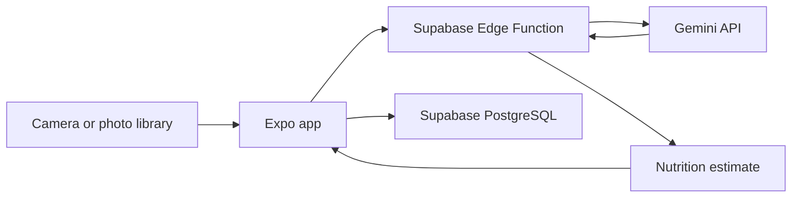

<div align="center">
  

  # CalcuM
  **Calcu by kktpx — a smarter way to track meals, nutrition, and progress.**

  [](https://expo.dev/)
  [](https://reactnative.dev/)
  [](https://www.typescriptlang.org/)
  [](https://supabase.com/)

  [Source Code](https://github.com/kktpx/CalcuM) · [Report an Issue](https://github.com/kktpx/CalcuM/issues)
</div>

## Overview

CalcuM is a mobile nutrition-tracking app built with **Expo, React Native, and TypeScript**. It combines daily calorie and macronutrient tracking with **AI-assisted food photo analysis**, a reusable food library, weight history, and personalized targets. Supabase powers authentication, stored data, and the server-side function used to analyze photos.

## Features

- **AI Food Scan** — take a photo or select an image to estimate a food's calories, protein, carbs, and fat before adding it to a meal.
- **Daily Dashboard** — compare consumed calories and macronutrients with personal daily targets.
- **Meal Logging** — record and remove meals, organized by meal type.
- **Saved Foods** — create a reusable food list and log frequently eaten items quickly.
- **Weight Tracking** — record daily weight and visualize recent changes on a chart.
- **Personal Goals** — update profile details and daily nutrition targets.
- **User Accounts** — sign-in flow and user-scoped data managed through Supabase.

> **Note:** Nutrition values inferred from a photo are estimates, not verified measurements or medical advice.

## Tech Stack

| Area | Technology | Purpose |
| --- | --- | --- |
| Mobile | React Native, Expo | Android/iOS application |
| Language | TypeScript | Type-safe application code |
| UI | React Native Paper, Expo Vector Icons, React Native SVG | Components, icons, charts |
| Backend | Supabase Auth, PostgreSQL | Authentication and persisted user data |
| Serverless | Supabase Edge Functions | Secure AI request handling |
| AI | Google Gemini API | Food image interpretation and nutrition estimates |
| Tests | Jest, jest-expo | Unit tests |

## How It Works



The **Gemini API key is held in the Edge Function's secrets**, not in the mobile app. Users can review a result before saving it to their meal history.

## Getting Started

### Requirements

- Node.js and npm
- Expo Go or an Android/iOS emulator compatible with your Expo SDK
- A Supabase project and Supabase CLI for database/function setup
- A Gemini API key for photo analysis

### 1. Install and start

```bash
git clone https://github.com/kktpx/CalcuM.git
cd CalcuM
npm install
```

Copy `.env.example` to `.env` and fill in the **public** Supabase credentials:

```env
EXPO_PUBLIC_SUPABASE_URL=https://your-project.supabase.co
EXPO_PUBLIC_SUPABASE_ANON_KEY=your-public-anon-key
```

### 2. Configure Supabase

Apply the SQL files in `supabase/migrations/` in filename order to a development Supabase project. Deploy the Edge Function and configure the private Gemini key:

```bash
supabase login
supabase link --project-ref YOUR_PROJECT_REF
supabase secrets set GEMINI_API_KEY=your_key
supabase functions deploy analyze-food
```

Keep JWT verification enabled for the Edge Function. Never store a Gemini key or Supabase service-role key in `EXPO_PUBLIC_*` variables.

### 3. Run the app

```bash
npm start
# or
npm run android
npm run ios
```

### 4. Run tests

```bash
npm test -- --runInBand
```

## Project Structure

```text
CalcuM/
├── App.tsx                    # Authentication and screen navigation
├── src/
│   ├── auth/                  # Authentication context
│   ├── components/            # Dashboard, charts, quick scan, navigation
│   ├── screens/               # Dashboard, Foods, Weight, Profile, Auth
│   ├── hooks/                 # Profile and async loading logic
│   └── lib/                   # Supabase calls, validation, nutrition helpers
├── supabase/
│   ├── functions/analyze-food/ # AI image analysis Edge Function
│   └── migrations/           # Database schema and policies
└── assets/                    # App icons and splash assets
```

## Security & Privacy

- The client uses only the Supabase public/anon key; keep privileged credentials server-side.
- Set up database Row Level Security using the provided migrations.
- Food photos are submitted to the AI service when users choose to scan them.
- Review the AI service's data-handling policies before using real personal information.

## License

See [LICENSE](LICENSE) for usage terms.

---

<div align="center">Built by <a href="https://github.com/kktpx">kktpx</a>.</div>
